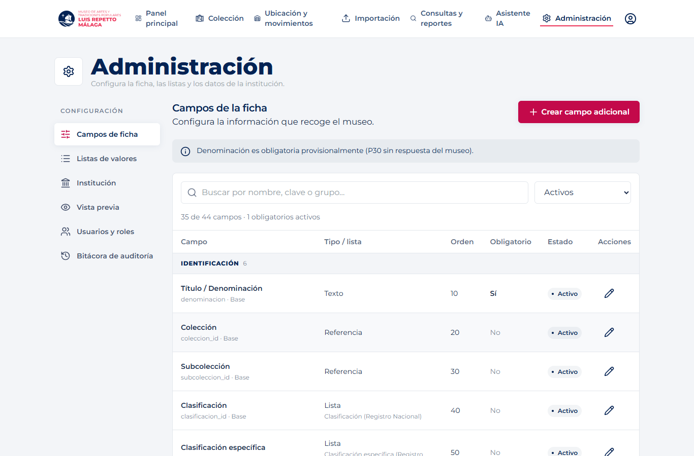
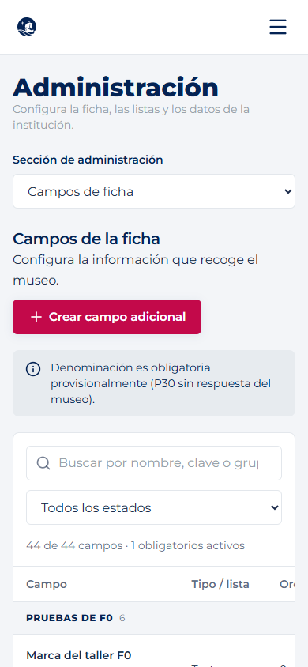
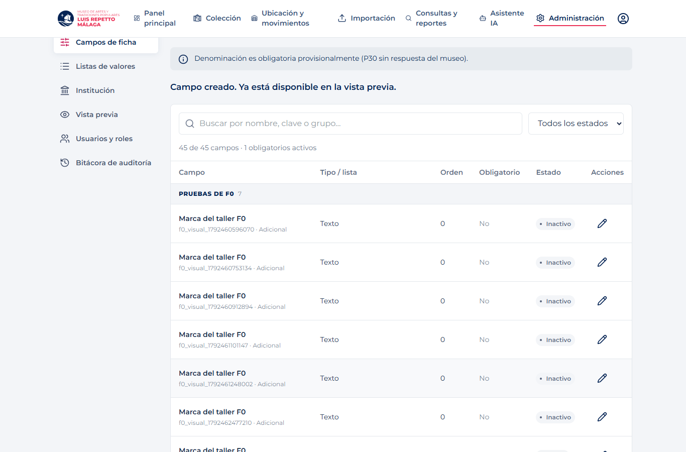
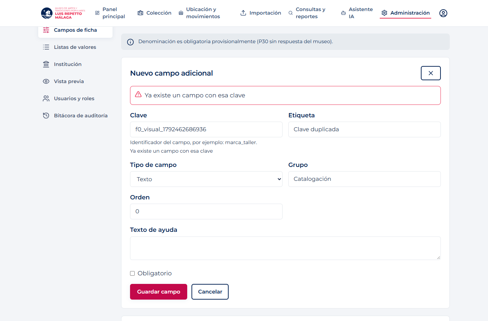
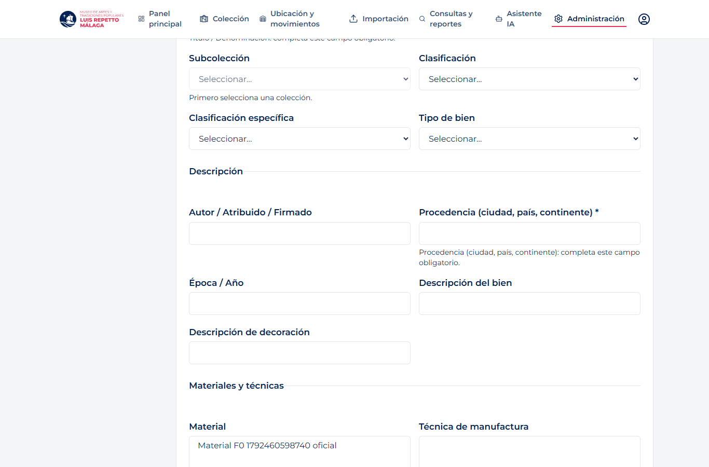
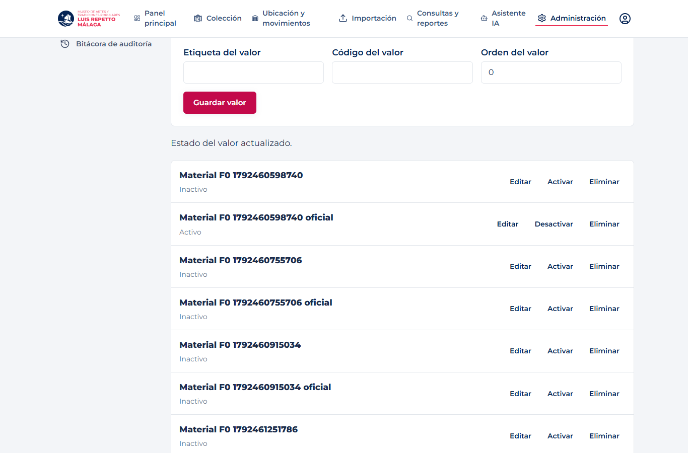
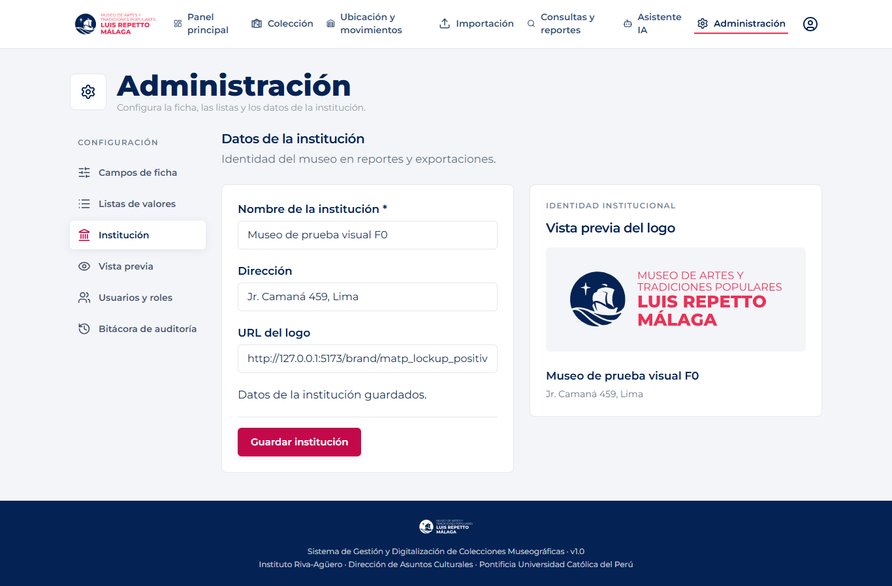
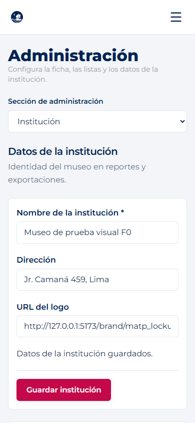
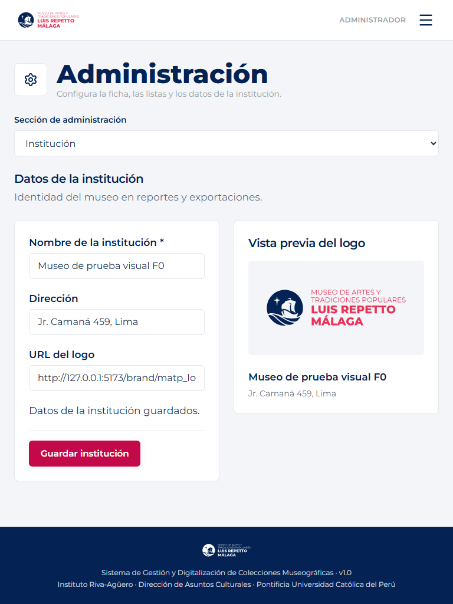
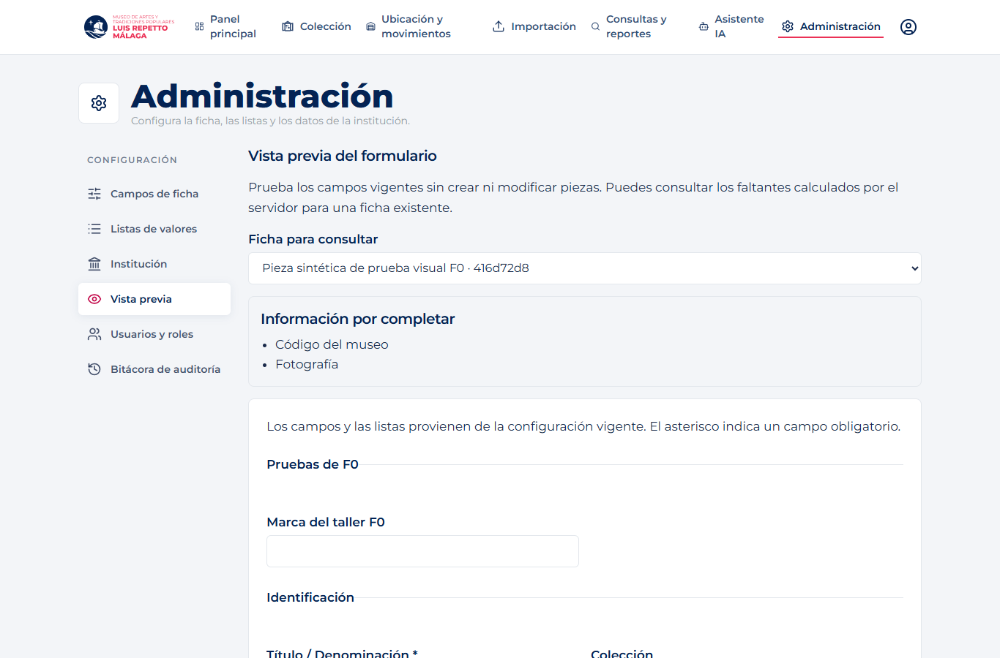

# F0 · Pantallas conectadas al contrato v3

Implementación en `alfredo/f0-frontend`. Contrato: [backend #42](https://github.com/dp2-app/museo-backend/pull/42), [especificación #10](https://github.com/dp2-app/Base-de-conocimiento/pull/10). Autorización específica del dueño de F0 para construir estas pantallas; las notas globales del equipo no se modifican.

## Verificación local · 19/10/2026

- `npm run build`: aprobado (TypeScript y Vite).
- `npm run lint`: sin errores. Se conservan **dos advertencias previas**, en `AuthContext.tsx` y `UbicacionMovimientosPage.tsx`; no se modifican esos archivos.
- Playwright + Chrome, con backend FastAPI real y PostgreSQL 17 local exclusivo, esquema `f0_temporal`, migración `0104_f0_cierre`.
- No se interceptan respuestas HTTP ni se usa MSW. Los datos sintéticos se escriben y consultan por API en la base exclusiva: los campos/valores nuevos se desactivan, la pieza de prueba se da de baja y se restauran los parámetros institucionales y la obligatoriedad temporal. Las cuentas y equivalencias de prueba permanecen solo en esa base aislada.
- La compilación y lint iniciales también pasaron, con las mismas dos advertencias. Backend local probado: commit F0 `72c1147` (contenido del PR #42); la actualización de la referencia remota de main encontró fallos de red durante esta sesión. No se certifica aquí una actualización del entorno desplegado.
- Ver [resultado.json](./evidencias/resultado.json), [Playwright](./playwright.txt), [build](./build.txt) y [lint](./lint.txt).

## Mejora visual de Administración · 19/10/2026

Navegación lateral en escritorio y selector de sección en móvil/tablet; cabecera más compacta. El catálogo ocupa una sola superficie con grupos, búsqueda por etiqueta/clave/grupo, filtro de activos/inactivos, contador y estado sin resultados. Conserva todos los campos por defecto. Las acciones de fila tienen menos peso visual, con nombres accesibles; se mantienen los tokens MATP/PUCP, el foco visible y las áreas táctiles de 44 px.

Institución separa el formulario de la vista previa de identidad; listas y formulario de ficha usan superficies y separadores consistentes. La tabla tiene desplazamiento propio y contención de pintura para impedir que expanda la página en móvil. Sin dependencias nuevas ni cambios de contrato.

**18 comprobaciones aprobadas** contra el backend real local: las 16 anteriores y dos nuevas para búsqueda/filtros/estado vacío y navegación móvil con catálogo sin desborde. Build aprobado y lint sin errores nuevos. Los problemas preexistentes de otros flujos siguen documentados más abajo.

## Comprobaciones funcionales

1. Login v3 (`accessToken`), rol/permisos desde `/auth/sesion` y retorno a Administración.
2. Extractor de errores compatible con `errores`, `detail` textual y lista Pydantic.
3. Crear un campo adicional y verlo en el catálogo y formulario reales.
4. Clave duplicada: error 409 del servidor junto al campo correspondiente.
5. Crear un campo de lista multivalor y comprobar controles de referencia, número y fecha.
6. Marcar procedencia obligatoria y comprobar su ayuda de validación en la vista previa; **ningún POST de piezas** desde la vista previa.
7. Denominación base sin opción de desactivar; la misma acción directa recibe 409 `campo_base`.
8. El componente que recibirá F2 conserva listas y excluye campos de solo lectura del payload.
9. Seleccionar una ficha real en la vista previa y mostrar «Código del museo» y «Fotografía» desde `camposFaltantes` del servidor.
10. Crear un valor, asociarlo a una pieza real de pruebas, intentar eliminarlo, recibir 409 y desactivarlo desde la UI.
11. Guardar equivalencias del Excel por API real.
12. Nombre institucional vacío: error junto al nombre y aviso honesto de guardado parcial (el backend guarda cada parámetro por separado).
13. URL de logo `ftp`: rechazada por el servidor y mostrada junto al campo.
14. Cambiar nombre/logo, cargar la imagen real y comprobar la institución vigente en inventario.
15. Escritorio, tablet (768 px) y móvil (390 px), sin desborde horizontal. Capturas verificadas visualmente.
16. Catalogador: 403 en configuración y sin acceso a Administración por URL directa.

## Capturas

## Regresión: problemas preexistentes fuera de F0

No se cambiaron `PiezasPage`, `PiezaDetailPage`, `ImportacionPage`, `CargaDetailPage`, `ConsultasReportesPage`, `PanelPrincipalPage` ni `AuthContext`. Tampoco sus tipos legados ni sus rutas. Se registraron estas incompatibilidades con v3; **no se afirma que esas pantallas estén funcionales**:

| Pantalla | Hallazgo | Origen en el código de main previo a F0 |
|---|---|---|
| Colección | Error de React al leer `.items.map` | Espera `{items}` de `/colecciones`; v3 devuelve una lista |
| Importación | 404 en `/api/v1/importacion/cargas` y `/plantillas` | v3 trasladó el flujo a `/datos/v1/importacion` |
| Consultas y reportes | 404 en `/vocabularios` y error al tratar colecciones como página | Contrato de listas y colecciones antiguo |
| Panel principal | Espera `alertas` y el indicador antiguo de restauración | El reporte v3 usa otras propiedades; no se adapta este flujo |

Los tres primeros se comprobaron en navegador; el panel se identificó revisando su código y el contrato. La evidencia compara las rutas y la lógica con main; no inventa una ejecución visual exitosa del frontend antiguo contra v3. Se requiere la migración de cada dueño de flujo. La entrada directa `/administracion` conserva la ruta durante el login y permite probar F0 sin depender del panel.

## Integración con F2 y F9

`components/f0/FormularioFicha` es un componente nuevo para F2; no reemplaza pantallas de piezas. Recibe `inicial`, `errores`, `onChange` y `onGuardar`. Sin `onGuardar` solo comprueba visualmente obligatorios, sin guardar piezas. Al guardar, el consumidor envía `{campos, listas}` y, en PATCH, la `version` vigente. Los campos de solo lectura/inactivos se excluyen; los errores del servidor se pintan por clave. La validación de negocio sigue en `validar_ficha()` del backend.

`CamposFaltantes` recibe **exactamente** `incompleta` y `camposFaltantes` del servidor, traduce claves con el catálogo y reconoce código/fotografía. No calcula exenciones por comodato en el navegador.

Para Angel S. (F9): el adaptador de `api.ts` normaliza solo el nombre de token del login v3 para el `AuthContext` actual; no altera el JWT. `usePermisos()` consulta la sesión y alimenta la navegación/guard. La caché F0 está separada por usuario/sesión; los datos no se comparten al cambiar de cuenta. Acordar con F9 la migración global posterior y la limpieza de caché de otros flujos. No se implementa visibilidad por rol ni se modifica AuthContext.

## Repetir las pruebas

Levantar el backend local con una **base exclusiva** en migración 0104, una cuenta administradora sintética y CORS para la URL local del frontend. Usar `VITE_API_BASE_URL=http://127.0.0.1:8000/api/v1` y abrir `/administracion`. Las credenciales no se incluyen en Git.

La prueba opcional `npm run test:f0` usa Playwright de un entorno de pruebas ya instalado (no se agregó ninguna dependencia al proyecto). Configurar `F0_PLAYWRIGHT_MODULE` con su ruta o tener `playwright` disponible, `F0_EMAIL`/`F0_PASSWORD`, y opcionalmente `F0_WEB`, `F0_API`, `F0_EVIDENCIA` y `F0_BROWSER_CHANNEL` (por defecto Chrome). La prueba rechaza destinos API no locales; no usarla contra el museo. También acepta un archivo de credenciales local con `F0_ACCOUNT_FILE`, nunca versionado.

## Demo visual del jueves 22

1. Entrar directamente a `/administracion`, iniciar sesión y abrir Campos de ficha.
2. Crear un campo adicional y verlo en Vista previa. Marcar otro obligatorio y comprobar que se señala al revisar el formulario.
3. Editar Denominación: mostrar que un campo base no permite desactivarse.
4. Abrir Listas, editar/desactivar un valor y mostrar el bloqueo de borrado de uno usado; revisar una equivalencia.
5. Abrir Institución, provocar un error de nombre/logo y corregirlo; mostrar el logo y su cambio en el reporte.
6. Seleccionar una ficha en Vista previa para ver los faltantes reales. Mostrar el diseño móvil y aclarar que la vista previa no guarda piezas.

## Pendientes

- Revisión de otra persona y del líder; estos PR no se fusionan automáticamente (DA-009).
- Confirmación de migración 0104 en Supabase y URL del backend desplegado. La verificación allí se hará únicamente cuando el dueño la confirme; no se probó contra Supabase.
- Migración de los demás flujos por sus dueños. La matriz no cambia automáticamente a Cumplido.
- El líder debe revisar las notas globales sin modificarlas en este PR: Base-de-conocimiento README líneas 65, 86 y 124; mapa-endpoints línea 171; museo-backend CLAUDE línea 79 (numeración de las copias actuales).
