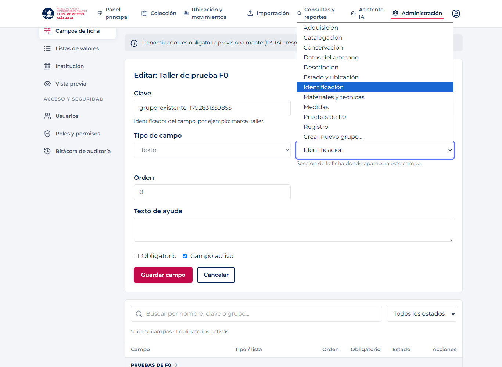
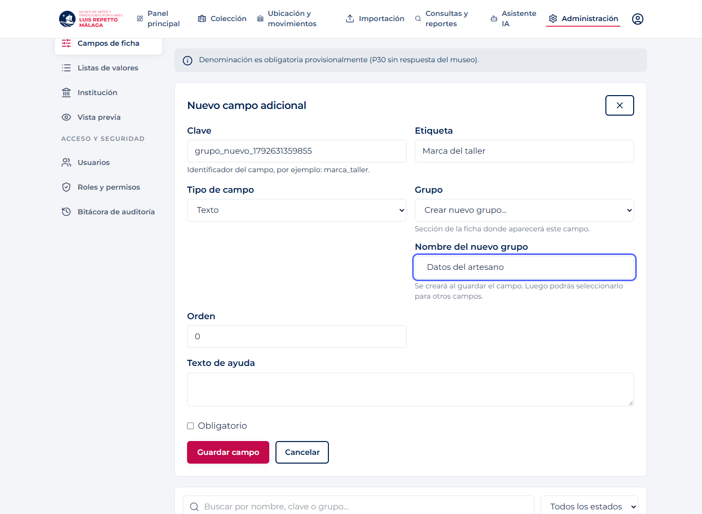
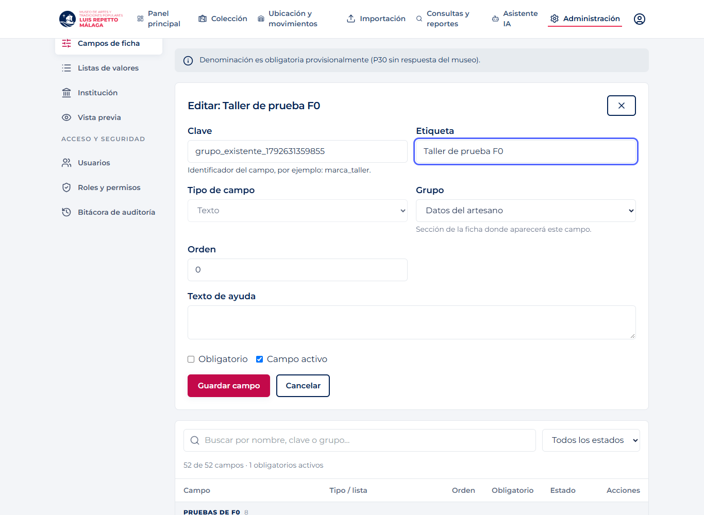
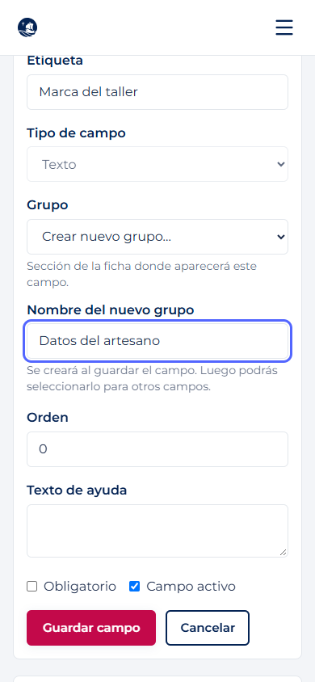

# F0 · Selector de grupos (21/10/2026)

El campo Grupo de alta y edición ahora permite elegir una sección existente o «Crear nuevo grupo…». Las opciones provienen del catálogo completo (incluidos campos inactivos), sin repetir nombres y ordenadas alfabéticamente. Se conserva el grupo actual. La ayuda explica dónde aparecerá el campo.

El grupo nuevo solo se persiste al guardar el campo, con espacios exteriores recortados. El nombre es obligatorio y no admite solo espacios. Elegir un grupo existente cancela la entrada nueva; cambiar de campo reinicia el selector. Sin cambios en backend, contrato, dependencias ni migraciones del producto.

## Verificación

- Nueve comprobaciones Playwright del selector, con Chrome y backend real.
- Las 18 comprobaciones existentes de F0 aprobadas, con la interacción Grupo adaptada al desplegable.
- Backend: copia de origin/main `e058bd1`, PostgreSQL local exclusivo de F0, esquema `f0_temporal`, actualizado a 0106. Nunca Supabase.
- Solo campos sintéticos: se desactivan al finalizar para conservar el historial. No se eliminan bases ni esquemas.
- Build y lint: ver archivos adjuntos. Lint mantiene las dos advertencias anteriores. Vite avisa del tamaño del paquete principal.

Repetir con `npm run test:f0:grupos` y las mismas variables de Playwright/credenciales del [guion F0](../README.md). Se rechazan APIs no locales. No versionar las credenciales.

Resultados: [selector](resultado.json), [regresión F0](regresion-f0.json).

## Capturas reales

