# F1 · Pantallas de identificadores y tenencia

Dueño: Angel Cerdán. Especificación: [`Base-de-conocimiento/flujos/F1.md`](https://github.com/dp2-app/Base-de-conocimiento/blob/main/flujos/F1.md). Contrato: `museo-backend` con el cierre de F1 ([backend #41](https://github.com/dp2-app/museo-backend/pull/41): `POST /codigos/validar`, `GET /tipos-codigo/{id}/siguiente`). Sigue el patrón de F0: contrato v3 real, sin MSW y con los componentes y estilos de `components/f0/`.

## Qué hay

| Dónde | Pantalla | Requisitos | Permiso para verla / para editar |
|---|---|---|---|
| Administración › Códigos y tenencia › **Tipos de código** | Catálogo de tipos y sus reglas (único, inmutable, correlativo, varios por pieza, formato) | RF-55, D3, D7, D8 | `config.codigos_tenencia` |
| Administración › Códigos y tenencia › **Regímenes** | Regímenes, requisitos (contraparte y fechas) y **qué códigos admite cada uno**. Marca el régimen que reciben las piezas nuevas | RF-56, RN-03, RN-04 | `config.codigos_tenencia` |
| Administración › Códigos y tenencia › **Propietarios** | Propietarios y contrapartes con búsqueda | RN-06 | `propietarios.ver` / `config.codigos_tenencia` |
| Colección › **Pendientes de código I** (`/coleccion/pendientes-codigo-i`) | Piezas sin I cuyo régimen lo admite; asignar el I con validación en vivo y el correlativo sugerido; corregir por excepción lo recién asignado | RF-06, D6, RF-04, D1, D4, RF-05 | `piezas.ver` / `codigos.gestionar`, `codigos.corregir_inmutable` |
| Colección › **Préstamos temporales** (`/coleccion/prestamos-temporales`) | Bienes recibidos en préstamo: no crean pieza | RN-04, RN-07 | `tenencias.ver` / `tenencias.gestionar` |

Los préstamos son trabajo diario y no configuración, por eso no van en Administración. Así el catalogador (que tiene `tenencias.gestionar`) los registra sin abrir la página de Administración, que sigue siendo solo de configuración (`PERMISOS_ADMINISTRACION`).

## Componentes para la ficha de F2

La ficha de la pieza es de F2 ([frontend #17](https://github.com/dp2-app/museo-frontend/pull/17)), que deja la corrección del código I (RF-05) pendiente. F1 entrega estos componentes listos para montar:

| Componente o hook | Archivo | Qué hace |
|---|---|---|
| `AgregarCodigo` | `components/f1/CampoCodigo.tsx` | Formulario para agregar un código: valida en vivo con `POST /codigos/validar` (modo `manual`), sugiere el correlativo y guarda con `POST /piezas/{id}/codigos`. `tipoFijo` oculta el selector |
| `CorregirCodigo` | `components/f1/CorregirCodigo.tsx` | RF-05: valor corregido + motivo de 10 caracteres o más; exige `codigos.corregir_inmutable` si el código está bloqueado |
| `ResultadoValidacion` | `components/f1/CampoCodigo.tsx` | Errores (bloquean), advertencias y valor normalizado junto al campo |
| `InsigniaPendienteI`, `AccesosF1` | `components/f1/PendienteCodigoI.tsx` | Insignia «Pendiente de código I» y accesos desde Colección |
| `useValidarCodigo`, `useSiguienteCorrelativo` | `hooks/useCodigosF1.ts` | Los mismos datos, para un formulario propio |
| `useTiposCodigo`, `useRegimenes`, `usePropietarios` | `hooks/useCatalogosF1.ts` | Catálogos con la caché por cuenta de F0 |
| `pendienteDeCodigoI`, `admite`, `puedeCorregir` | `lib/f1.ts` | El criterio de D6 y de los permisos, para pintar la insignia o el botón sin otra consulta |

Los tipos están en `src/types/f1.ts` (archivo propio, para no chocar con los de otros flujos).

**Validar una corrección.** `validar_codigos` no sabe qué código se corrige: con `piezaId` respondería «la pieza ya tiene un código de ese tipo». `CorregirCodigo` valida sin pieza ni régimen, igual que `corregir_codigo` del backend (solo formato y unicidad). Si solo cambia la forma de escribir el mismo código (`I-1` → `I-0001`), el normalizado coincide y no lo trata como duplicado.

## Pruebas · 21/10/2026

Todas contra el backend real (`angel/f1-cierre` con `main` integrado) y PostgreSQL 17 local exclusivo, sin interceptar respuestas:

- `npm run build`: aprobado.
- `npm run lint`: sin advertencias nuevas (siguen las dos previas, en `AuthContext.tsx` y `UbicacionMovimientosPage.tsx`).
- `npm run test:f1`: **16 comprobaciones aprobadas** ([resultado.json](./evidencias/resultado.json)).
- Regresión: `test:f0`, `test:f0:grupos` y `test:f9` (15) aprobadas con los cambios de esta rama.
- `museo-backend`: 191 pruebas de pytest aprobadas.

Comprobaciones de `test:f1`:

1. Grupo «Códigos y tenencia» en Administración con los tipos sembrados y sus reglas.
2. El código I se edita (correlativo) pero no ofrece desactivarse (D7).
3. Un patrón inválido se rechaza junto a su campo; el tipo con formato se crea (RF-55).
4. Clave repetida: error del servidor junto a la clave.
5. D8: exigir «único» con valores repetidos se rechaza y se explica junto a la regla.
6. Régimen nuevo con sus códigos admitidos; el comodato no admite el I y Propiedad sigue siendo el régimen por defecto (RF-56, RN-03).
7. Registrar un propietario y encontrarlo por nombre o documento (RN-06).
8. Un préstamo temporal aparece en la lista y no crea pieza (RN-04, T06).
9. Pendientes: aparece la pieza en propiedad sin I; no las que tienen I ni las de comodato (T10, T11).
10. Validación en vivo: un I asignado escrito de otra forma (`i 12345`) se detecta como duplicado antes de guardar (D1, T04).
11. Asignar el I con el correlativo sugerido: queda bloqueado y la pieza sale de pendientes (D4, RF-04).
12. Corregir el I exige un motivo de 10 caracteres o más y queda guardado y auditado (RF-05, T08, T09).
13. Catalogador: las acciones se muestran según sus permisos y la API rechaza el resto (403).
14. Consulta interna: ídem.
15. Móvil (390 px): navegación por selector y sin desborde horizontal.
16. Sin errores de JavaScript.

### Hallazgo durante las pruebas

Una pieza nueva sin régimen recibe **el primer régimen activo de inventario según su `orden`** (`regimen_por_defecto` del backend). Un régimen creado con orden 0 desplazaba a Propiedad sin que nadie lo notara. Por eso el formulario propone el orden siguiente al mayor, explica la regla junto al campo y marca el régimen «Por defecto en piezas nuevas».

## Repetir las pruebas

Backend local con una **base exclusiva** que termine en una migración que incluya F1 (#41), y CORS para la URL del frontend. Frontend con `VITE_API_BASE_URL=http://127.0.0.1:8000/api/v1`. Nunca contra Supabase.

```
F1_PLAYWRIGHT_MODULE=<ruta a playwright> F1_ACCOUNT_FILE=<cuentas.json> F1_BROWSER_CHANNEL=msedge npm run test:f1
```

`cuentas.json` (nunca versionado) trae `admin`, `catalogador` y `consulta`, cada una con `email` y `password`, de los roles Administrador, Catalogador/practicante y Consulta interna. Opcionales: `F1_WEB`, `F1_API`, `F1_EVIDENCIA`. La prueba rechaza una API que no sea local. Deja datos sintéticos en esa base (tipos, un régimen, un propietario, un préstamo y piezas con el sufijo de la corrida) y restaura lo que cambia del catálogo sembrado (el correlativo del I).

## Capturas

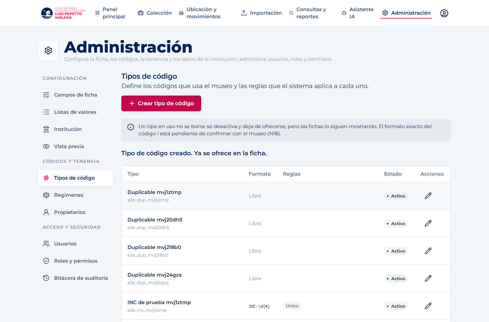
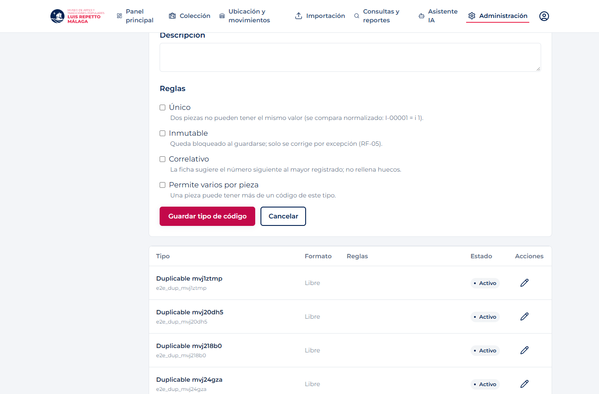
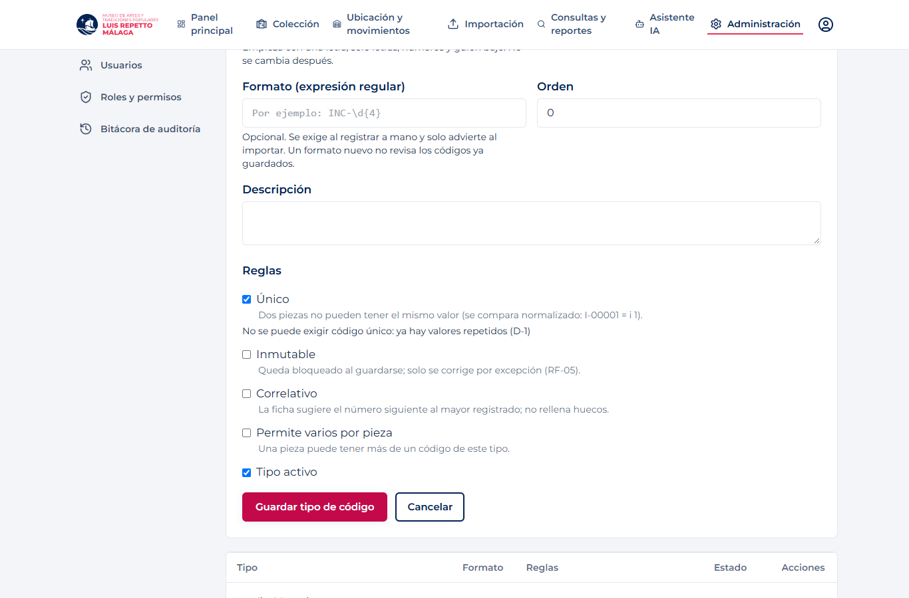
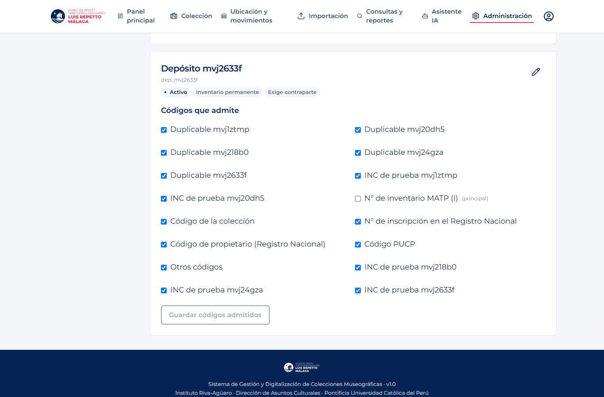
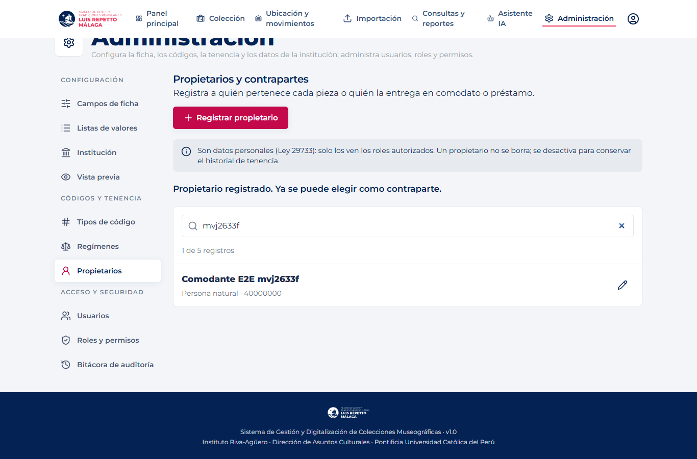
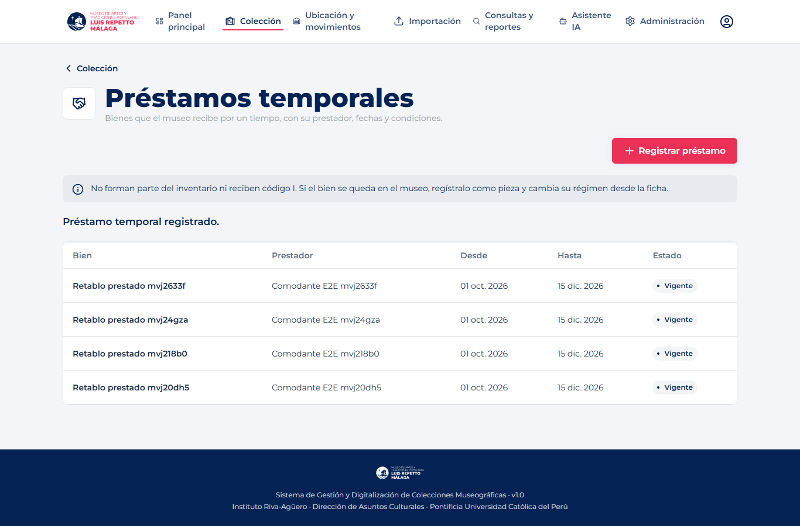
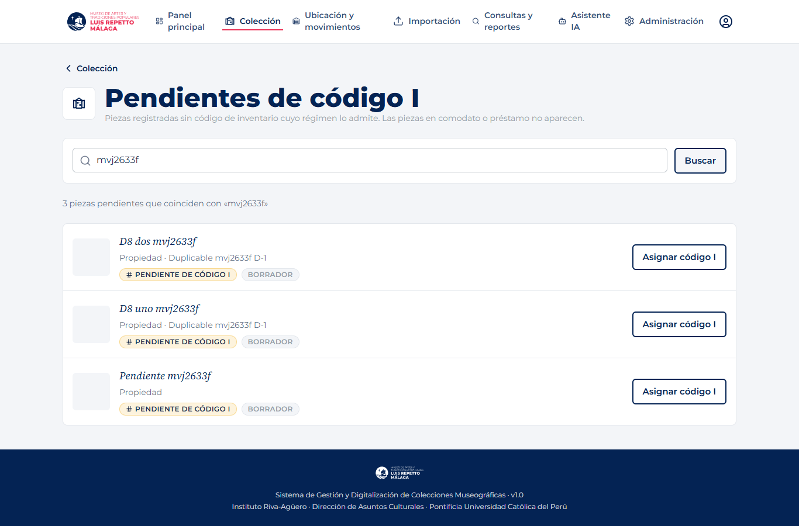
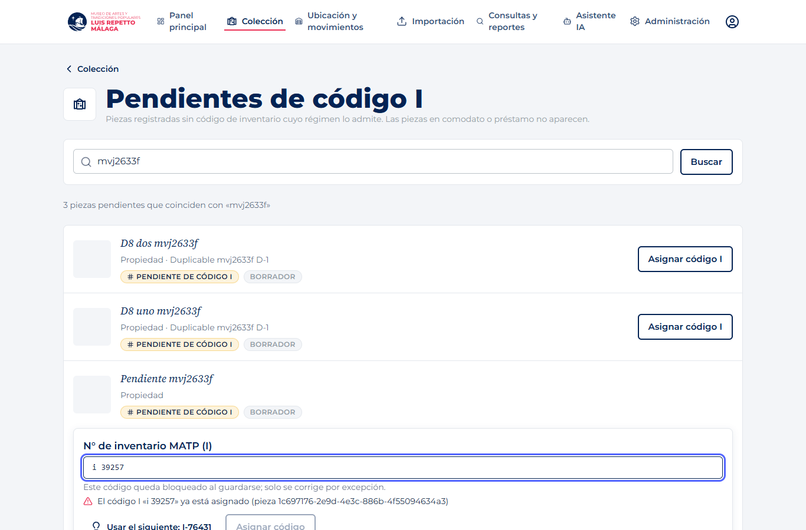
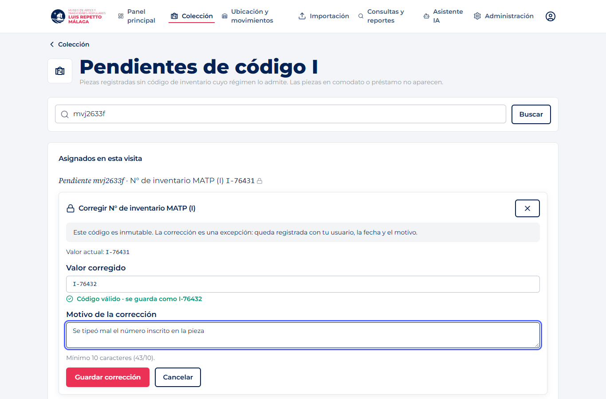
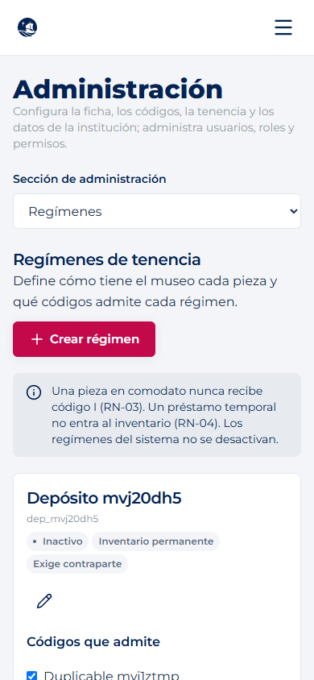
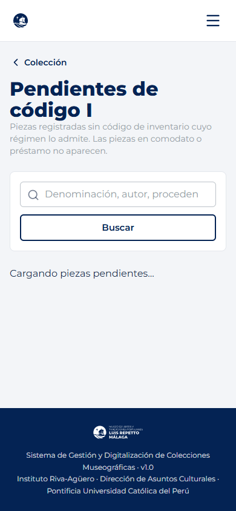

## Pendientes

- **Colección de `main` no carga con el v3** (pantalla del contrato anterior; la reemplaza #17). Hasta que entre #17, a Pendientes y Préstamos se llega por su URL. #17 debe conservar la línea `<AccesosF1 />` en `PiezasPage`.
- Montar `CorregirCodigo` (y, si F2 quiere, `AgregarCodigo` e `InsigniaPendienteI`) en la ficha de #17. Lo coordinan F1 y F2.
- Requiere backend #41 (validar y correlativo) en el backend desplegado.
- N17–N19 siguen sin respuesta del museo: el formato del I y si es correlativo cambian la configuración, no el código.
- Revisión de otra persona y del líder (DA-009). La matriz de cobertura no se marca como Cumplido desde aquí.
