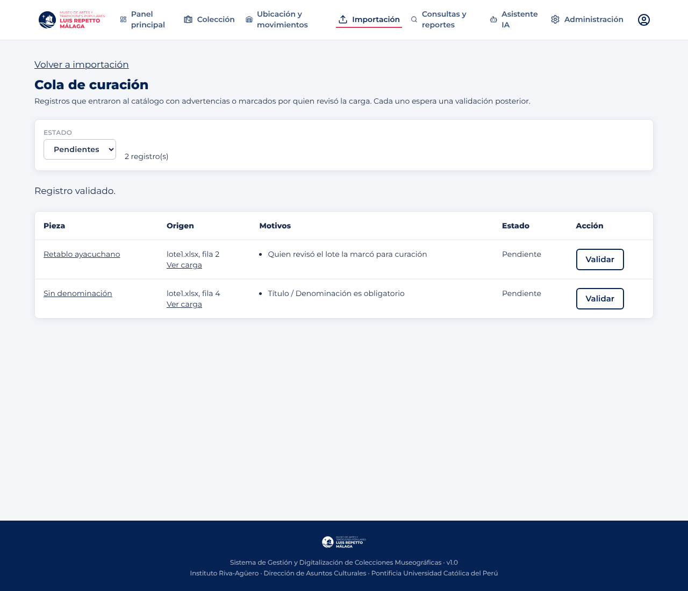
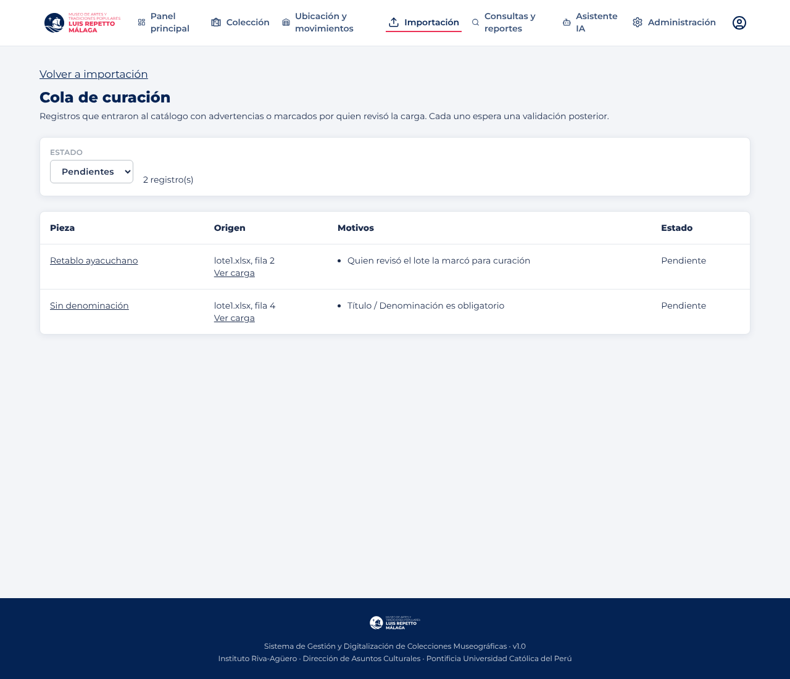
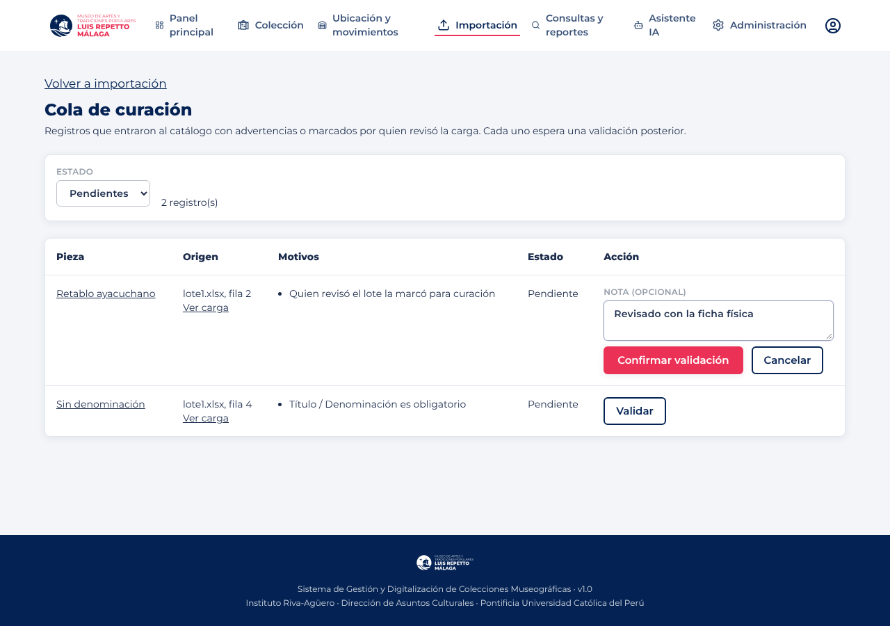
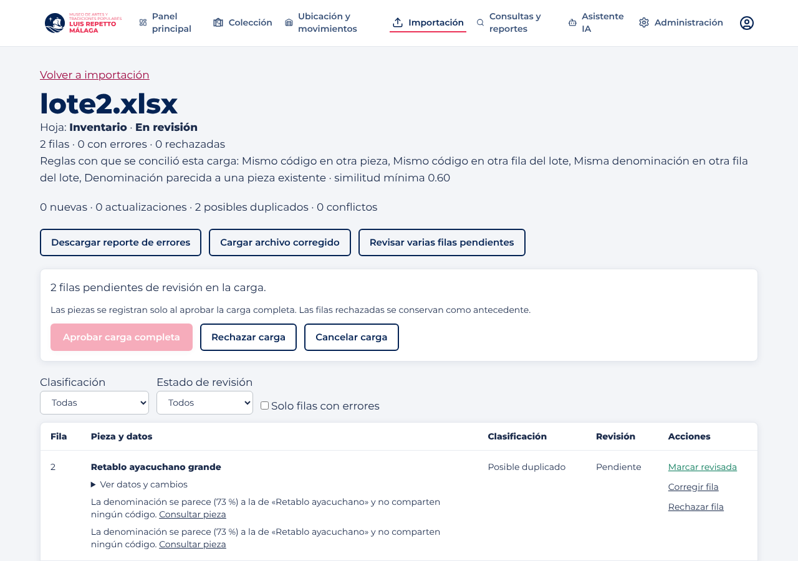

# F5 · frontend de Importación (conciliación y aprobación)

Especificación: [`Base-de-conocimiento/flujos/F5.md`](https://github.com/dp2-app/Base-de-conocimiento/blob/main/flujos/F5.md).
Contrato: `museo-backend/docs/openapi.yaml` (rutas `/datos/v1/importacion/*`).

## Avance

| Issue | Alcance | Estado |
|---|---|---|
| #22 | Importación sobre `/datos/v1` y tipos del contrato v3 | Hecho en `main` (PR #28, `datosApi`); este flujo agrega solo los tipos de F5 |
| #23 | Revisión del lote: resumen, candidatos, cambios, aprobar/rechazar/cancelar (RF-32, RF-33, RF-34, RF-36) | Cubierta por el PR #28; «enviar a curación» por fila en #31 (`feat/31-enviar-fila-a-curacion`) |
| #24 | Bitácora de cargas con reglas aplicadas y datos de origen en la ficha (RF-37, RF-39) | Pendiente |
| #25 | Reglas de duplicado, umbral y aprobador (RF-58) | Hecho en `feat/25-reglas-importacion`: panel plegable en Importación (`components/f5/ReglasImportacion.tsx`) |
| #26 | Cola de curación (RF-40, deseable) | Pendiente |

## Tipos de F5 (`src/types/index.ts`)

`CargaExcel.reglasAplicadas`, `ReglasImportacion` / `ReglaDuplicado` y `CuracionImportacion`, según `openapi.yaml`.

## Enviar una fila a curación (#31)

En el detalle de una carga en revisión, cada fila tiene «Enviar a curación» / «Quitar de curación»
(`PATCH …/filas/{id}` con `curacionPendiente`). La fila marcada muestra «Irá a la cola de curación al aprobar la carga».
Evidencia: `docs/f5/evidencias/enviar-a-curacion.png`. Probado en el navegador contra el backend local: marcar, quitar,
volver a marcar, revisar las filas, aprobar la carga y comprobar en `GET /datos/v1/importacion/curacion` el pendiente con el
motivo `marcada_por_revision`; sin respuestas 4xx ni errores de página.
## Reglas de importación (#25)

Panel plegable en `/importacion` sobre `GET/PUT /datos/v1/importacion/reglas`:

- Activa o apaga las tres reglas configurables; la del mismo código (RF-32) se muestra fija.
- Umbral de similitud entre 0,30 y 1,00 (el servidor valida de nuevo).
- Permiso aprobador (P33): la lista sale de `GET /permisos`, que exige `roles.ver`; sin ese permiso se muestra el vigente, sin cambiarlo.
- Cambiar reglas exige `importacion.configurar`; ver, `importacion.ver`. «Requiere aprobación» no se puede apagar (RN-08).
- Quien tenga el permiso aprobador puede aprobar también una carga que subió (F5-P1 sigue abierta con el museo).

Evidencia: `docs/f5/evidencias/reglas-importacion.png`. En el navegador, contra el backend local: valores iniciales
(0,60, `importacion.aprobar`), rechazo local de 0,10, guardado de 0,75 con una regla apagada, y persistencia tras recargar,
sin respuestas 4xx ni errores de página.

## Prueba automática de F5 (#36)

`npm run test:f5` (`tests/f5.e2e.cjs`, Playwright) recorre contra el backend real y una base local **vacía** (nunca Supabase):
reglas y umbral con persistencia (RF-58), carga de un Excel, enviar/quitar/volver a enviar una fila a curación y aprobar el lote
con el pendiente en la cola (RF-36, RF-40), las reglas que guarda cada carga (RF-39) y la cancelación con motivo. Crea datos:
corre una vez por base; deja las reglas con sus valores por defecto. Variables: `F5_EMAIL` y `F5_PASSWORD` (un administrador
local), y opcionales `F5_WEB`, `F5_DATOS`, `F5_EVIDENCIA` y `F5_PLAYWRIGHT_MODULE`. Los Excel están en `tests/fixtures/f5/`.
También recorre la cola de curación en pantalla y valida el pendiente con nota (#32 y #33). Son 10 controles `OK`.

## Verificación

- `npm run build` y `npm run lint` (solo las dos advertencias previas).
- Contra el backend local con la migración `0107` (sin Supabase): el recorrido de importación del PR #28 sigue funcionando
  tras integrar `main` con este flujo.

## Cola de curación (#32)

Ruta `/importacion/curacion` (`CuracionImportacionPage`), enlazada desde Importación para quien tiene `importacion.ver` y `piezas.ver`.
Lista `GET /datos/v1/importacion/curacion` con filtro por estado (pendientes por defecto) y paginación de 50. Cada fila muestra la pieza
(enlace a su ficha), el archivo y la fila de origen (enlace a la carga), los motivos y el estado. La validación con nota es el issue #33.

Verificado contra el backend local con `0107`: se cargó `lote1.xlsx`, se envió una fila a curación, se aprobó la carga y la cola mostró
la fila marcada («Quien revisó el lote la marcó para curación») y la fila sin título («Título / Denominación es obligatorio»), sin errores 4xx.

## Validar un pendiente (#33)

En la cola, quien tiene `importacion.curar` ve el botón «Validar» en cada pendiente: abre una nota opcional y «Confirmar validación» llama a
`POST /datos/v1/importacion/curacion/{id}/validar`. El backend guarda quién y cuándo; la cola muestra la fecha y la nota. Sin ese permiso no
aparece la columna de acción (el backend responde 403 de todos modos).

Verificado contra el backend local: se validó un pendiente con nota, la cola de pendientes bajó de 2 a 1 y el filtro «Validados» mostró fecha y nota, sin errores 4xx.

## Bitácora con reglas aplicadas (#34)

El detalle de cada carga muestra «Reglas con que se concilió esta carga» (`reglasAplicadas` de la carga, RF-39): las reglas de duplicado
activas, con su etiqueta, y la similitud mínima de ese momento. Así una carga vieja conserva las reglas con que se revisó aunque luego se
cambien en Importación. Las etiquetas se leen de `GET /datos/v1/importacion/reglas`; si no están disponibles se muestra la clave.

Verificado contra el backend local: tras cargar `lote2.xlsx` el detalle lista las cuatro reglas y «similitud mínima 0.60», sin errores 4xx.

## Tablas en el celular (#49)

Bajo 768 px las tablas del detalle de la carga y de la cola de curación (clase `tabla-apilable` en `src/index.css`) muestran cada fila como tarjeta, con el encabezado de cada celda (`data-label`) y las acciones debajo. A 375 px ningún botón queda fuera de la pantalla (`scrollWidth` = 375); en escritorio la tabla no cambia.

## Mejoras del recorrido de revisión (2/11/2026)

Salen de un recorrido completo del flujo con cuatro roles, en escritorio y celular, contra el backend de `main` y una base local (no se probó en el sitio desplegado).

- **Aprobar pide confirmación.** «Aprobar carga completa» abre un resumen (piezas nuevas, actualizaciones, posibles duplicados que se registrarán como piezas distintas, filas rechazadas) y recién «Confirmar aprobación» llama a `POST …/aprobar`.
- **Un posible duplicado no se revisa a ciegas.** «Marcar revisada» abre, junto a la fila, el aviso de que se registrará como pieza nueva; hay que confirmar con «Registrar como pieza distinta» (la regla D7 de `flujos/F5.md` no cambia).
- **Aviso de código ausente.** Si ninguna fila mostrada trae código del museo, la pantalla lo dice antes de aprobar (las piezas quedarían pendientes de código I).
- **Paneles junto a la fila.** Rechazar, corregir y confirmar un duplicado se abren debajo de su fila, uno a la vez, con el número de fila en el título.
- **Corregir fila usa los mismos controles que la ficha.** `EditorFila` reutiliza `Control` de `components/f0/FormularioFicha.tsx` con `porNombre`: listas y referencias (colección, subcolección, propietario, régimen, ubicación) son selectores, las listas multivalor son selección múltiple, y números y fechas usan su input. El valor que se envía es el texto (etiqueta o nombre) porque así lo resuelve el backend al importar (`datosCorregidos`). Un valor del Excel que no está en la lista se conserva como opción «valor original», y uno que no tiene el formato del campo (p. ej. «16 a 20 cm») se muestra como texto. Los códigos del museo siguen siendo texto.
- **Acciones con estado visible.** Las acciones deshabilitadas se ven deshabilitadas; el reporte de errores solo se ofrece si hay errores; los avisos no repiten el nombre del campo y explican que la pieza entra a curación.
- **Curación.** La cola avisa si la pieza sigue sin denominación y aclara que validar no corrige la ficha.
- **Historial de cargas.** Muestra fecha, quién cargó y el motivo de una carga rechazada o cancelada; filtro por estado y «Mostrar más».
- **Reglas.** Los permisos se listan con su descripción; un rol de solo lectura ve todas las casillas deshabilitadas.
- **Otros.** Singular y plural en los contadores (`src/lib/texto.ts`), selector de archivo en español, texto secundario y botón principal con contraste AA (axe sin hallazgos en las tres pantallas) y una nota sobre la diferencia entre rechazar y cancelar una carga.

Pruebas: `npm run test:f5` (actualizada: confirmación de aprobación y aviso de código) pasa 10 de 10; `tests/importacion.e2e.cjs` se actualizó para el paso de confirmación, pero no se ejecutó (necesita los archivos de `IMPORTACION_*`).

## Hallazgos del sitio desplegado (2/11/2026)

- **Enlaces directos:** `vercel.json` manda todas las rutas a `index.html`; sin esa regla recargar o abrir `/login` o `/importacion` daba el 404 de Vercel.
- **Cargas anteriores a F5:** el detalle dice «Esta carga es anterior al registro de reglas de duplicado» en vez de «ninguna regla activa» cuando la carga no guardó sus reglas.
- **Servidor dormido:** el login avisa a los 4 s que el servidor está despertando y que puede tardar hasta un minuto.
