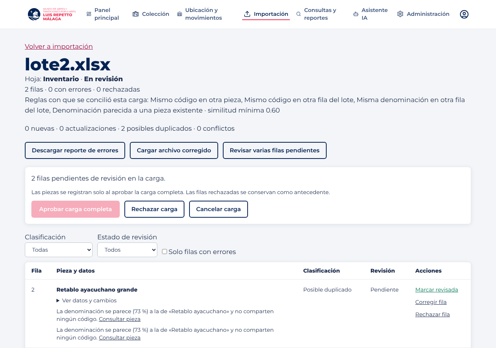

# F5 · frontend de Importación (conciliación y aprobación)

Especificación: [`Base-de-conocimiento/flujos/F5.md`](https://github.com/dp2-app/Base-de-conocimiento/blob/main/flujos/F5.md).
Contrato: `museo-backend/docs/openapi.yaml` (rutas `/datos/v1/importacion/*`).

## Avance

| Issue | Alcance | Estado |
|---|---|---|
| #22 | Importación sobre `/datos/v1` y tipos del contrato v3 | Hecho en `main` (PR #28, `datosApi`); este flujo agrega solo los tipos de F5 |
| #23 | Revisión del lote: resumen, candidatos, cambios, aprobar/rechazar/cancelar (RF-32, RF-33, RF-34, RF-36) | Cubierta por el PR #28; falta «enviar a curación» por fila |
| #24 | Bitácora de cargas con reglas aplicadas y datos de origen en la ficha (RF-37, RF-39) | Pendiente |
| #25 | Reglas de duplicado, umbral y aprobador (RF-58) | Pendiente |
| #26 | Cola de curación (RF-40, deseable) | Pendiente |

## Tipos de F5 (`src/types/index.ts`)

`CargaExcel.reglasAplicadas`, `ReglasImportacion` / `ReglaDuplicado` y `CuracionImportacion`, según `openapi.yaml`.

## Verificación

- `npm run build` y `npm run lint` (solo las dos advertencias previas).
- Contra el backend local con la migración `0107` (sin Supabase): el recorrido de importación del PR #28 sigue funcionando
  tras integrar `main` con este flujo.

## Bitácora con reglas aplicadas (#34)

El detalle de cada carga muestra «Reglas con que se concilió esta carga» (`reglasAplicadas` de la carga, RF-39): las reglas de duplicado
activas, con su etiqueta, y la similitud mínima de ese momento. Así una carga vieja conserva las reglas con que se revisó aunque luego se
cambien en Importación. Las etiquetas se leen de `GET /datos/v1/importacion/reglas`; si no están disponibles se muestra la clave.

Verificado contra el backend local: tras cargar `lote2.xlsx` el detalle lista las cuatro reglas y «similitud mínima 0.60», sin errores 4xx.

