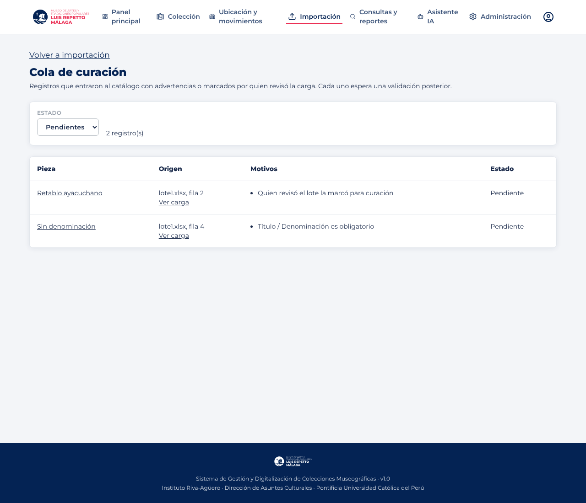
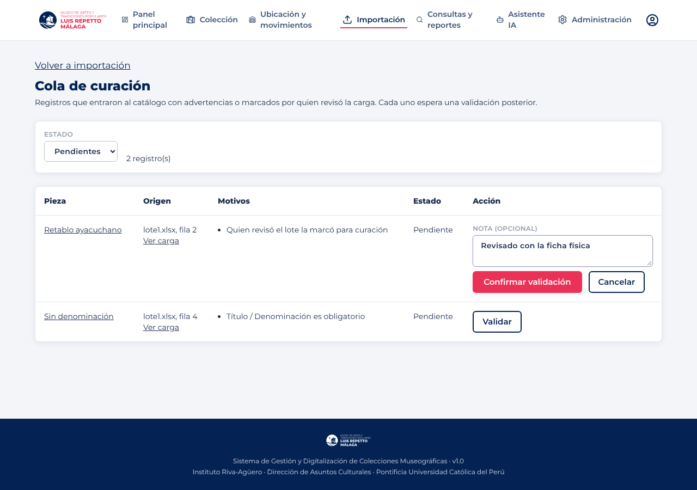

# F5 · frontend de Importación (conciliación y aprobación)

Especificación: [`Base-de-conocimiento/flujos/F5.md`](https://github.com/dp2-app/Base-de-conocimiento/blob/main/flujos/F5.md).
Contrato: `museo-backend/docs/openapi.yaml` (rutas `/datos/v1/importacion/*`).

## Avance

| Issue | Alcance | Estado |
|---|---|---|
| #22 | Importación sobre `/datos/v1` y tipos del contrato v3 | Hecho en `main` (PR #28, `datosApi`); este flujo agrega solo los tipos de F5 |
| #23 | Revisión del lote: resumen, candidatos, cambios, aprobar/rechazar/cancelar (RF-32, RF-33, RF-34, RF-36) | Cubierta por el PR #28; falta «enviar a curación» por fila |
| #24 | Bitácora de cargas con reglas aplicadas y datos de origen en la ficha (RF-37, RF-39) | Pendiente |
| #25 | Reglas de duplicado, umbral y aprobador (RF-58) | Pendiente |
| #26 | Cola de curación (RF-40, deseable) | Pendiente |

## Tipos de F5 (`src/types/index.ts`)

`CargaExcel.reglasAplicadas`, `ReglasImportacion` / `ReglaDuplicado` y `CuracionImportacion`, según `openapi.yaml`.

## Verificación

- `npm run build` y `npm run lint` (solo las dos advertencias previas).
- Contra el backend local con la migración `0107` (sin Supabase): el recorrido de importación del PR #28 sigue funcionando
  tras integrar `main` con este flujo.

## Cola de curación (#32)

Ruta `/importacion/curacion` (`CuracionImportacionPage`), enlazada desde Importación para quien tiene `importacion.ver` y `piezas.ver`.
Lista `GET /datos/v1/importacion/curacion` con filtro por estado (pendientes por defecto) y paginación de 50. Cada fila muestra la pieza
(enlace a su ficha), el archivo y la fila de origen (enlace a la carga), los motivos y el estado. La validación con nota es el issue #33.

Verificado contra el backend local con `0107`: se cargó `lote1.xlsx`, se envió una fila a curación, se aprobó la carga y la cola mostró
la fila marcada («Quien revisó el lote la marcó para curación») y la fila sin título («Título / Denominación es obligatorio»), sin errores 4xx.

## Validar un pendiente (#33)

En la cola, quien tiene `importacion.curar` ve el botón «Validar» en cada pendiente: abre una nota opcional y «Confirmar validación» llama a
`POST /datos/v1/importacion/curacion/{id}/validar`. El backend guarda quién y cuándo; la cola muestra la fecha y la nota. Sin ese permiso no
aparece la columna de acción (el backend responde 403 de todos modos).

Verificado contra el backend local: se validó un pendiente con nota, la cola de pendientes bajó de 2 a 1 y el filtro «Validados» mostró fecha y nota, sin errores 4xx.

