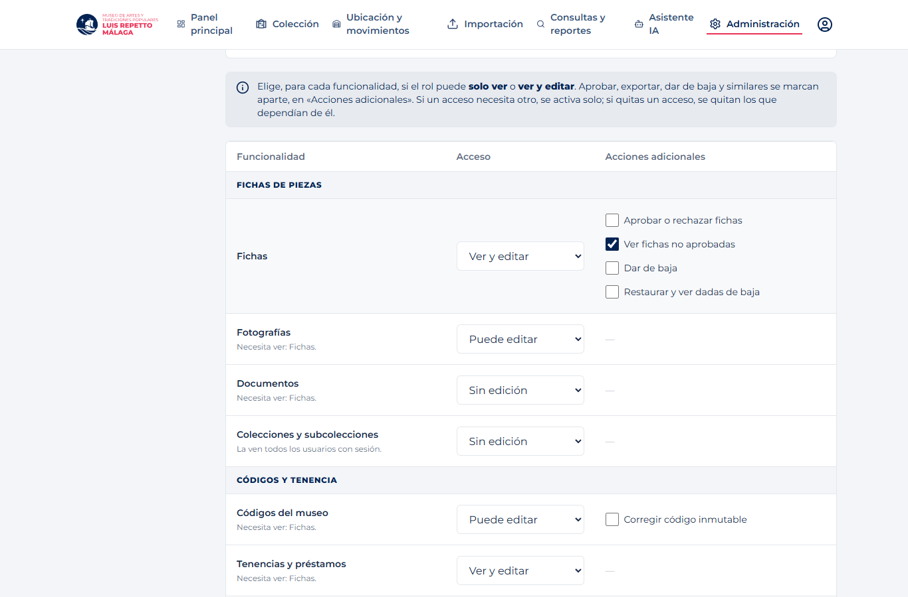
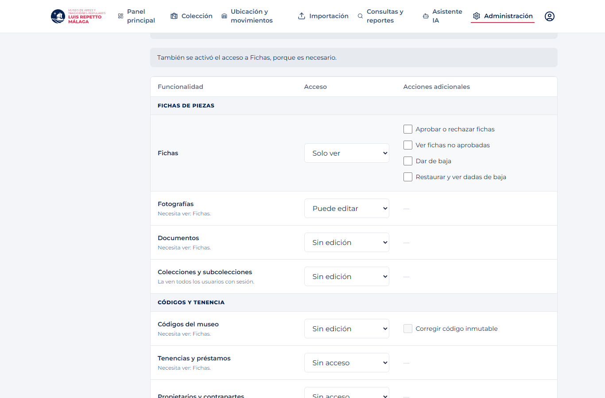
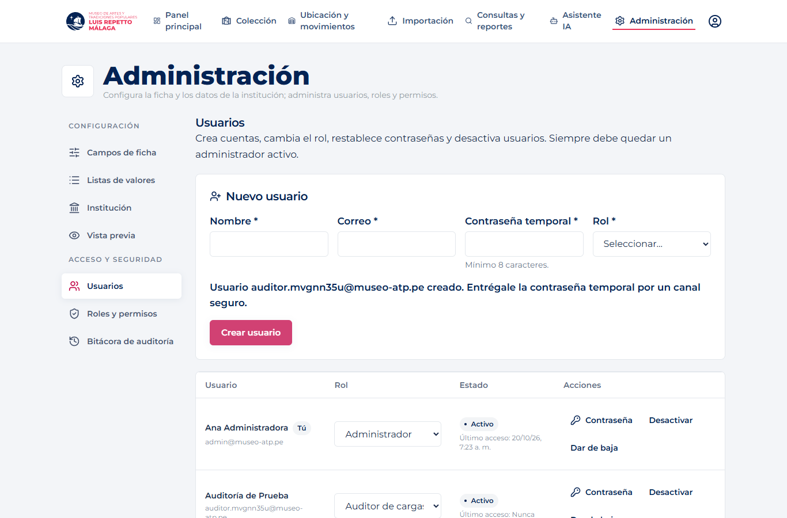
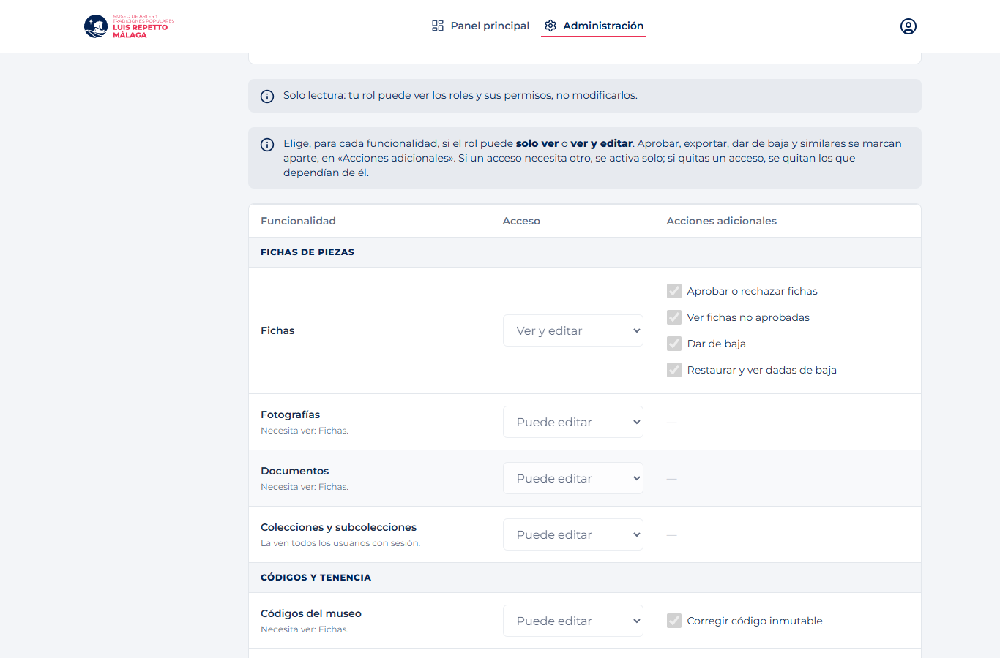
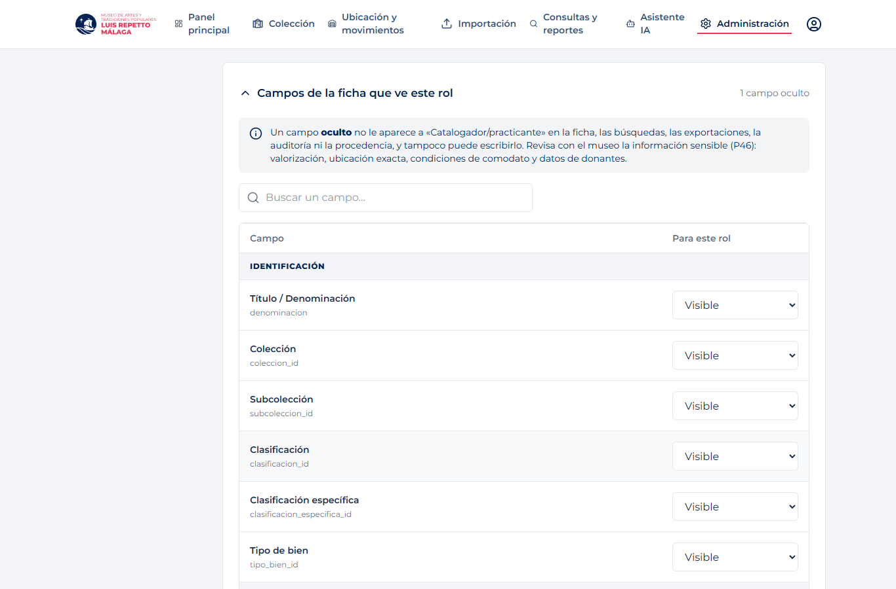
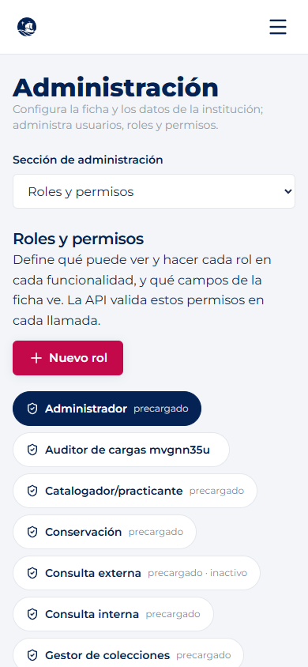

# F9 · Roles, permisos y acceso en la interfaz

Backend: `museo-backend` (migración `0105_f9_permisos_por_accion`, especificación `specs/requirements/f9-acceso-roles-permisos.md`).
Conocimiento: `Base-de-conocimiento/flujos/F9.md`.

## Qué cambia en la interfaz

- **Menú y rutas por permiso, no por nombre de rol** (`src/lib/secciones.ts`, `components/RequirePermiso.tsx`). Una sección aparece si el usuario tiene
  al menos uno de sus permisos; entrar por URL sin permiso redirige al inicio. La API vuelve a validar cada acción (RNF-08).
- **Administración → Roles y permisos**: elige un rol y, para cada funcionalidad, un desplegable de acceso: **Sin acceso / Solo ver / Ver y editar**
  (donde no hay permiso «ver» propio: Sin edición / Puede editar). Aprobar, exportar, dar de baja y similares se marcan aparte en «Acciones adicionales».
  Si un acceso necesita otro (editar fotografías necesita ver fichas) se activa solo, y si se quita se quitan los que dependían de él; la pantalla lo avisa.
  Se puede crear un rol partiendo de otro. `src/components/f9/`, lógica de niveles en `src/lib/permisos.ts`.
- **Mismo lugar: campos de la ficha que ve el rol** (RF-57): sección plegable con un desplegable Visible / Oculto por campo; se guarda junto con el rol.
  Ya no hay una pantalla aparte «Visibilidad por rol».
- **Administración → Usuarios**: alta, cambio de rol, restablecer contraseña, desactivar y dar de baja. Mensaje claro si se intenta dejar al sistema sin
  administrador (RN-12).
- **Administración → Bitácora**: paginada y filtrable; muestra quién, cuándo, antes y después.
- **Solo lectura**: cada sección tiene su permiso «ver» y su permiso «editar»; con solo «ver» desaparecen los botones y los desplegables quedan deshabilitados.
  También se aplicó a *Campos de ficha* e *Institución* (F0).
- `components/ErrorBoundary.tsx`: una pantalla que falla ya no deja la aplicación en blanco (ver «Pantallas sin adaptar»).

## Verificación local · 20/10/2026

- `npm run build`: aprobado. `npm run lint`: sin errores; las 2 advertencias son las que ya existían (`AuthContext.tsx`, `UbicacionMovimientosPage.tsx`).
- `npm run test:f9` (Playwright + Chrome, **backend real** y PostgreSQL 17 local exclusivo, sin interceptar respuestas): 15 comprobaciones aprobadas
  ([resultado.json](./evidencias/resultado.json)). Cubre: menú derivado de permisos, dependencias entre funcionalidades, rol nuevo con una combinación, usuario con ese rol
  que solo ve y hace lo permitido, 403 en llamadas directas, el cambio rige sin volver a iniciar sesión, rol de solo lectura, visibilidad de un campo desde la pantalla de roles, bitácora y móvil.

```
F9_PLAYWRIGHT_MODULE=<ruta a playwright> F9_PASSWORD=<clave de las cuentas locales> npm run test:f9
```

Solo corre contra `localhost`: crea roles y usuarios que no se pueden borrar (RN-05).

| | |
|---|---|
|  |  |
|  |  |
|  |  |

## Orden de despliegue

La interfaz usa permisos nuevos (`usuarios.ver`, `roles.ver`, `config.campos.ver`, `config.institucion.ver`, `config.visibilidad.ver`, `importacion.ver`…) que **solo existen
después de aplicar la migración `0105`**. Primero la migración y el backend; después el frontend. Con el frontend nuevo y el backend anterior, nadie vería «Administración».

## Pantallas sin adaptar (no son de F9)

Colección, Importación y Consultas y reportes siguen con el contrato anterior (ver `docs/f0/README.md`). Aquí solo se cambió su control de acceso a
permisos; con v3 pueden mostrar el aviso del `ErrorBoundary` hasta que su dueño las migre.

**Panel principal** (pantalla de inicio de todos los usuarios): se adaptó lo mínimo al contrato v3 en un commit aparte, para que no falle al abrir la sesión.
Lee `piezasRequierenAtencion` (antes `piezasRequierenRestauracion`), muestra «Sin fotografía» y «—» si el rol no ve la ubicación (`piezasSinUbicacion` es `null`),
y la lista de alertas solo aparece si la API la entrega (v3 no la incluye). El dueño de F7/F8 puede reemplazarlo al migrar la pantalla completa.
